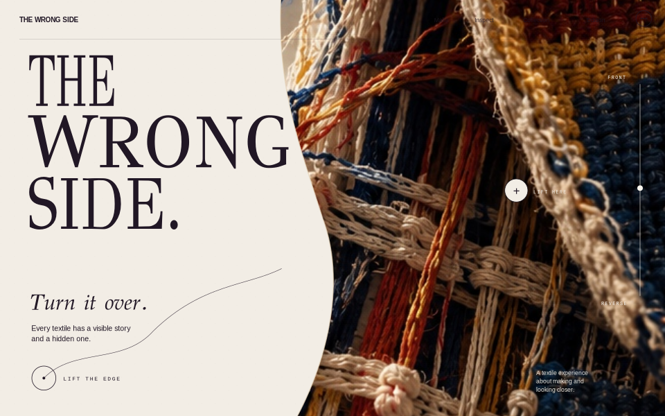
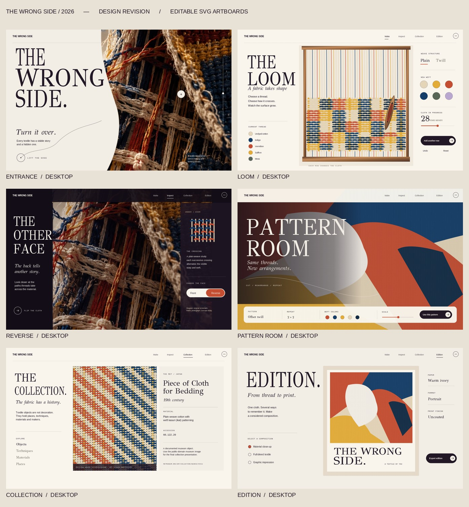
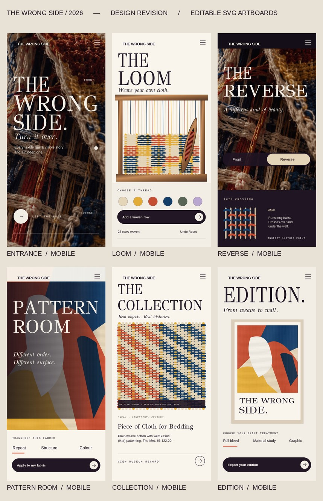

# THE WRONG SIDE

**A digital textile exhibition for making, turning, and looking closer.**



[Explore the design artboards](Design/REVIEW_ALL.html) · [Technical notes](docs/TECHNICAL_ARCHITECTURE.md) · [Build status](docs/BUILD_STATUS.md) · [Creative review](docs/CREATIVE_REVIEW.md)

> **Release note:** This repository contains six implemented local experiences. It has not yet been independently verified as a public production deployment. The Entrance's art-direction photograph is provisional, and complete release testing is still a separate milestone. Design previews are not necessarily live-site screenshots.

---

## The experience

The idea begins with a simple observation: a cloth has a visible surface and a hidden construction. THE WRONG SIDE explores both, through a connected visitor-made textile and a researched collection of historical works.

| Explore | What happens |
| :-- | :-- |
| **Entrance** | An editorial material encounter and the invitation to examine the other side. |
| **Loom** | Choose yarn colors and a supported weave, add rows, undo/redo, and save the construction. |
| **Reverse** | Lift and turn the same cloth; inspect yarn crossings derived from its interlacement data. |
| **Pattern Room** | Reweave or recolor real yarns; separately compose finite graphic arrangements. |
| **Collection** | Explore eleven documented historical textiles with source-attributed images and interpretation. |
| **Edition** | Turn the visitor's material into an editorial print, with full-bleed, material-study, and graphic layouts; export PNG or hybrid SVG. |



<details>
<summary>View mobile design studies</summary>



</details>

## Built with

**Next.js 16 · React 19 · TypeScript · Tailwind CSS 4 · GSAP · Canvas 2D · SVG**

The textile is stored as structured warp/weft yarn data and crossing rules, not independent pictures for its front and back. Plain weave, 2/2 twill, and defined satin/sateen rules are supported. The reverse view mirrors and complements the crossing arrangement while retaining the original yarn identities.

Canvas rendering adds authored lighting, contact shadows, rounded yarns, and fiber detail. **This is a mathematically consistent interlacement model, not a validated simulation of fabric dynamics.** The lifted-edge motion is an art-directed material interpretation.

The visitor's construction stays consistent across the making, inspection, pattern, and print experiences. JSON files support explicit saving and restoration. The print exporter uses the same underlying yarn data.

## Run locally

Requires **Node.js 20.9+** and npm.

```bash
npm ci
npm run dev
```

Open **http://127.0.0.1:3000**.

```bash
npm run typecheck
npm test
npm run lint
npm run build
npm run test:e2e
```

The automated and browser checks above are available scripts, not a claim that every release check has already passed. The high-resolution print route uses a Node-compatible Canvas dependency and bundled fonts; production hosting must support it.

## Research, sources and rights

The Collection contains eleven works researched from The Metropolitan Museum of Art, Cleveland Museum of Art, Cooper Hewitt, and the National Museum of American History. Museum objects are kept distinct from visitors' procedural compositions.

- [Object-level research and provenance](docs/COLLECTION_RESEARCH.md)
- [Asset register and license notes](docs/ASSET_REGISTER.md)
- [Art direction and design reference audit](docs/ART_DIRECTION.md)
- [Engineering and known limitations](docs/BUILD_STATUS.md)

Collection photos are institution-sourced under recorded public-domain/CC0 terms. Visual design artboards are project-specific studies. The provisional Entrance concept artwork must not be confused with a physically reconstructed historical textile.

## Project structure

```text
src/app/           Route experiences and Edition export API
src/components/    Loom, Reverse, Pattern, Collection and Edition UIs
src/lib/           Weave model, renderers, workers and metadata
public/images/     Procedural posters and credited museum imagery
Design/            Editable SVG artboards and previews
tests/             Weave, rendering, export and browser checks
docs/              Art direction, research, status and audit evidence
```

---

**A project by [Salman Yousufzai](https://salmn.dev).**  
[Portfolio](https://salmn.dev) · [GitHub profile](https://github.com/Salman-41) · [Contact](mailto:salmn.contact@gmail.com)
